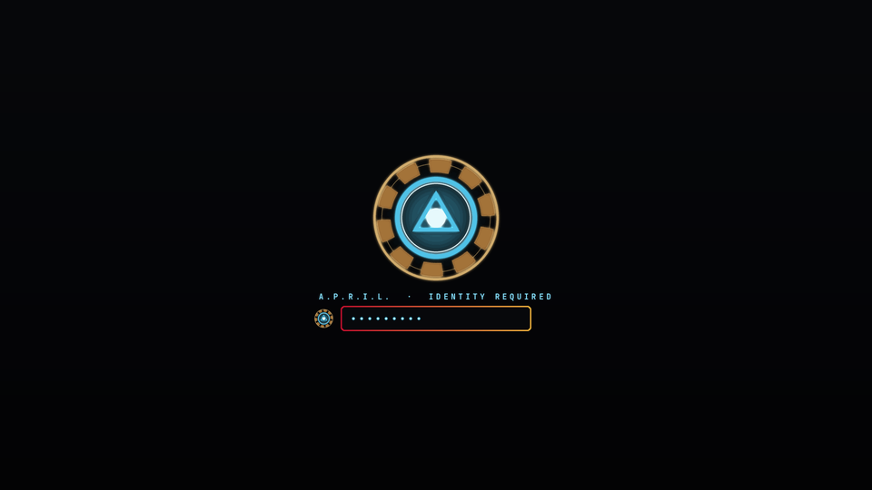
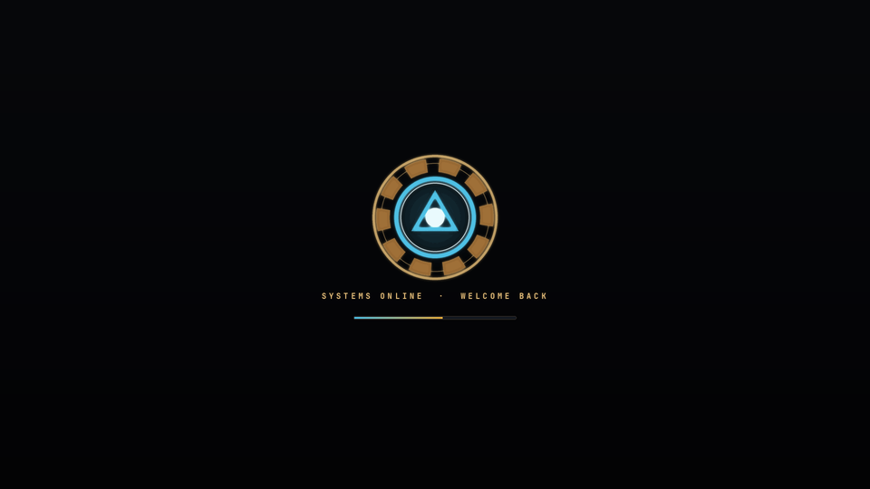

# Iron Man for Omarchy

A Mark-armour theme for [Omarchy](https://omarchy.org): gunmetal blueprint
backgrounds, candy-apple crimson and titanium gold, and arc-reactor blue for
everything that glows.


## Install

```bash
omarchy theme install https://github.com/Benadict-Git/omarchy-iron-man-theme
```

Or pick **Iron Man** later from `omarchy theme switcher`.

## What's in it

**Palette** (`colors.toml`), which Omarchy turns into matching configs for
Hyprland, the terminals, btop, Neovim, VS Code, Chromium and the rest:

| Role | Colour | |
|---|---|---|
| Background | `#121418` | gunmetal |
| Foreground | `#e7ddd0` | warm ivory |
| Accent | `#efb13c` | titanium gold |
| Red | `#c8102e` | hot-rod crimson |
| Cyan / Blue | `#4fc3e8` / `#3e8fc4` | arc reactor |

Focused windows get a crimson-to-gold gradient border.

**Shell surfaces** (`shell.*.toml`): an opaque near-black HUD bar with
champagne-gold icons and red alerts; solid popups, menus, notifications and the
polkit prompt framed in the red-to-gold armour gradient; arc-blue hover and
focus states. The lock screen's password field glows arc-blue at rest,
red-to-gold while you type, and red on a wrong password.

**Backgrounds**: *Arc Reactor* and *J.A.R.V.I.S. HUD*, both original,
generated renders.

**Icons**: `Yaru-red-dark`.

**Boot splash** (`unlock.png`): an arc reactor, used if you run
`omarchy plymouth set by theme iron-man`.

## Extra: animated arc-reactor boot unlock screen

`extras/plymouth` is an optional Plymouth theme for the disk-encryption
password screen. It isn't part of the Omarchy theme and needs root to install.

- The reactor flickers on and powers up, then idles with a turning coil ring
  and a breathing core.
- The prompt reads "A.P.R.I.L. · IDENTITY REQUIRED" above a red-to-gold
  password field with glowing dots.
- After unlocking, the screen switches to "SYSTEMS ONLINE · WELCOME BACK" with a
  blue-to-gold boot progress bar.

The password handling is Omarchy's own, unchanged; only the visuals differ.

| Asking for the password | Booting |
|---|---|
|  |  |

```bash
cd ~/.config/omarchy/themes/iron-man
sudo bash extras/plymouth/install.sh          # install and rebuild the initramfs
sudo bash extras/plymouth/install.sh --undo   # back to Omarchy's screen
```

It rebuilds the boot images with `limine-mkinitcpio` (Omarchy's default), or
`mkinitcpio -P` without Limine. It refuses to install with less than 200 MB free
in `/boot`, and switches back to the previous theme if the rebuild fails.

To name your own assistant and yourself, regenerate the captions:

```bash
cd extras/plymouth
ASSISTANT="F.R.I.D.A.Y." NAME="Tony" python3 source/make_assets.py theme
```

That needs Python with Pillow and NumPy.

## License

MIT, see [LICENSE](LICENSE). This is an unofficial fan theme. Iron Man is a
trademark of Marvel; this project is not affiliated with or endorsed by Marvel
or Disney.
