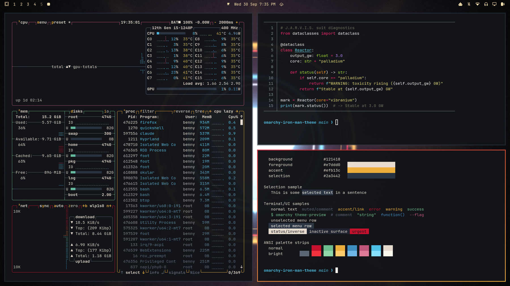

# Iron Man for Omarchy

A Mark-armour theme for [Omarchy](https://omarchy.org): gunmetal blueprint
backgrounds, candy-apple crimson and titanium gold, and arc-reactor blue for
everything that glows.



## Install

```bash
omarchy theme install https://github.com/Benadict-Git/omarchy-iron-man-theme
```

Or pick **Iron Man** later from `omarchy theme switcher`.

## What's in it

**Palette** (`colors.toml`), which Omarchy turns into matching configs for
Hyprland, the terminals, btop, Neovim, VS Code, Chromium and the rest:

| Role | Colour | |
|---|---|---|
| Background | `#121418` | gunmetal |
| Foreground | `#e7ddd0` | warm ivory |
| Accent | `#efb13c` | titanium gold |
| Red | `#c8102e` | hot-rod crimson |
| Cyan / Blue | `#4fc3e8` / `#3e8fc4` | arc reactor |

Focused windows get a crimson-to-gold gradient border.

**Shell surfaces** (`shell.*.toml`): an opaque near-black HUD bar with
champagne-gold icons and red alerts; solid popups, menus, notifications and the
polkit prompt framed in the red-to-gold armour gradient; arc-blue hover and
focus states. The lock screen's password field glows arc-blue at rest,
red-to-gold while you type, and red on a wrong password.

**Backgrounds**: *Arc Reactor* and *J.A.R.V.I.S. HUD*, both original,
generated renders.

**Icons**: `Yaru-red-dark`.

**Boot splash** (`unlock.png`): an arc reactor, used if you run
`omarchy plymouth set by theme iron-man`.

## License

MIT, see [LICENSE](LICENSE). This is an unofficial fan theme. Iron Man is a
trademark of Marvel; this project is not affiliated with or endorsed by Marvel
or Disney.
